<p align="center">
  
</p>

<h1 align="center">BengkelYann</h1>

<p align="center">
  Aplikasi desktop manajemen bengkel berbasis C# Windows Forms dan SQL Server.
</p>

<p align="center">
  
  
  
  
</p>

---

## Tentang Proyek

**BengkelYann** adalah aplikasi desktop untuk mengelola operasional bengkel kendaraan, mulai dari pendataan customer dan kendaraan, pembuatan Work Order (WO), permintaan sparepart, pengerjaan oleh mekanik, pembayaran, hingga pencetakan struk dan laporan PDF.

Aplikasi ini memiliki pembagian hak akses berdasarkan peran pengguna:

| Peran | Tanggung Jawab |
|---|---|
| **Admin** | Mengelola master data, pengguna, laporan, dan audit log |
| **Frontdesk** | Mendata customer/kendaraan, membuat Work Order, memonitor dan menyerahkan kendaraan |
| **Gudang** | Mengelola stok sparepart, barang masuk, dan permintaan sparepart |
| **Mekanik** | Melihat job yang ditugaskan, mengisi detail servis, dan mengajukan permintaan sparepart |
| **Kasir** | Memproses pembayaran, mencetak struk, dan mengekspor riwayat transaksi ke PDF |

## Fitur Utama

- Login multi-role dengan sesi pengguna.
- Dashboard ringkasan operasional bengkel.
- Master data customer, kendaraan, supplier, sparepart, jasa, dan pengguna.
- Pembuatan Work Order dengan nomor otomatis berformat `WO-YYYYMMDD-NNN`.
- Monitoring status Work Order: `Baru`, `Dikerjakan`, `Menunggu sparepart`, `Selesai`, `Diserahkan`, dan `Sudah dibayar`.
- Alur permintaan, persetujuan, dan penolakan sparepart.
- Detail servis dan perhitungan biaya jasa serta sparepart.
- Pembayaran, cetak struk, dan pencatatan transaksi.
- Riwayat transaksi dengan filter periode dan ekspor laporan PDF.
- Audit log untuk mencatat aktivitas pengguna (login, logout, tambah, edit, hapus, pembayaran, serah terima, permintaan sparepart, ekspor PDF, dan lainnya).

## Screenshot dan Penjelasan Fitur per Hak Akses

Galeri berikut memperlihatkan tampilan form asli aplikasi untuk **Admin, Frontdesk, Gudang, Mekanik, dan Kasir**. Screenshot diambil pada ukuran bawaan masing-masing form sesuai Windows Forms Designer, tanpa memperbesar jendela atau mengubah tata letak kontrol, sehingga logo tetap berada di kanan atas sesuai desain. Hanya area antarmuka aplikasi yang diambil, tanpa bingkai judul Windows.

Gunakan tautan berikut untuk langsung menuju hak akses yang ingin dilihat:

- [Admin — pengelolaan dan pemantauan bengkel](#1-admin)
- [Frontdesk — penerimaan dan monitoring kendaraan](#2-frontdesk)
- [Gudang — persediaan dan permintaan sparepart](#3-gudang)
- [Mekanik — penugasan dan detail servis](#4-mekanik)
- [Kasir — penagihan dan riwayat pembayaran](#5-kasir)

> Screenshot menggambarkan data yang tersedia saat pengambilan, bukan data yang wajib ada pada instalasi baru. Daftar Invoice dan Permintaan Sparepart terlihat kosong karena belum ada WO siap tagih atau permintaan yang sedang diproses. Klik gambar untuk melihatnya dalam ukuran penuh. Semua gambar disimpan di [`docs/screenshots/`](docs/screenshots/).

### 1. Admin

Admin menangani master data, pengaturan pengguna, serta pemantauan operasional dan pendapatan bengkel.

#### Dashboard

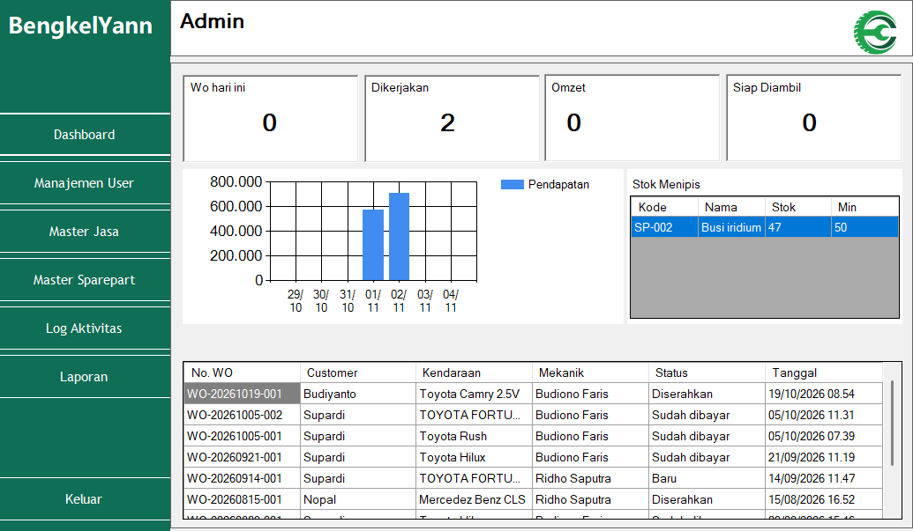

- **Ringkasan operasional:** kartu menampilkan WO hari ini, pekerjaan aktif, omzet hari ini, serta kendaraan berstatus selesai yang siap diambil. Hitungan pekerjaan aktif mencakup status `Baru`, `Dikerjakan`, dan `Menunggu sparepart`.
- **Grafik pendapatan:** menampilkan pendapatan tujuh hari terakhir agar admin dapat melihat perubahan pemasukan bengkel.
- **Stok menipis:** menampilkan sparepart dengan stok kurang dari atau sama dengan stok minimum sebagai acuan pengadaan.
- **WO terbaru:** menampilkan sepuluh WO terakhir beserta customer, kendaraan, mekanik, status, dan tanggalnya.

#### Manajemen User

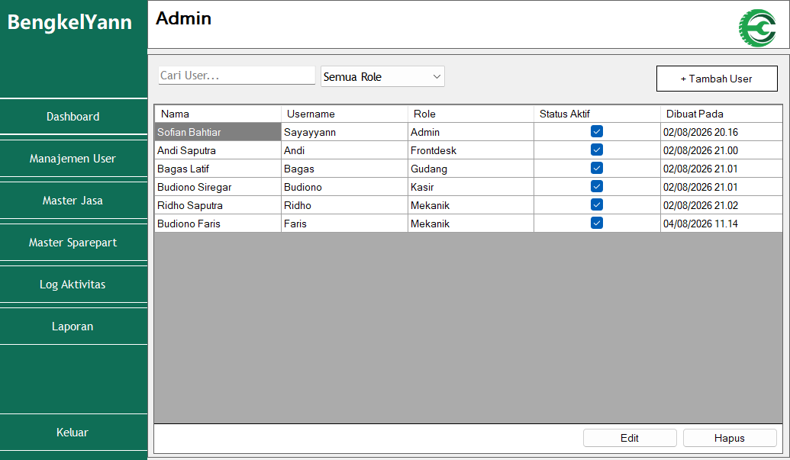

- Daftar akun menampilkan nama lengkap, username, role, status aktif, dan tanggal pembuatan akun.
- Pencarian berdasarkan **nama atau username** dapat digabungkan dengan filter role untuk menemukan pengguna tertentu.
- Admin dapat menambah akun, mengedit data akun, serta menghapus akun dengan konfirmasi. Role menentukan menu yang dapat diakses pengguna.
- Saat mengedit, password dapat dibiarkan kosong apabila tidak ingin diubah. Status aktif ditampilkan sebagai informasi pada tabel.

#### Master Jasa

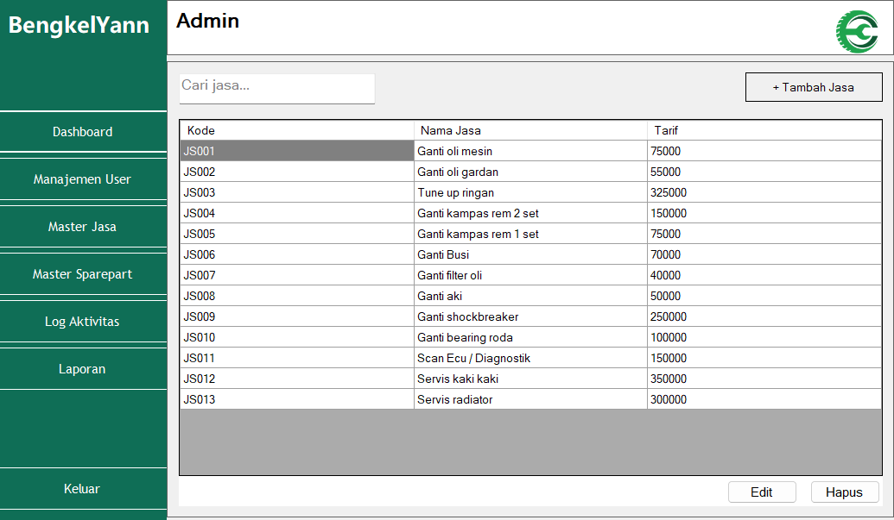

- Menyimpan katalog layanan bengkel berupa **kode jasa, nama jasa, dan tarif**.
- Pencarian membantu admin menemukan layanan tanpa menelusuri seluruh tabel.
- Fasilitas tambah, edit, dan hapus digunakan untuk memelihara daftar layanan yang akan dipilih mekanik pada detail servis.
- Tarif pada master menjadi referensi biaya jasa saat jasa dimasukkan ke WO.

#### Master Sparepart

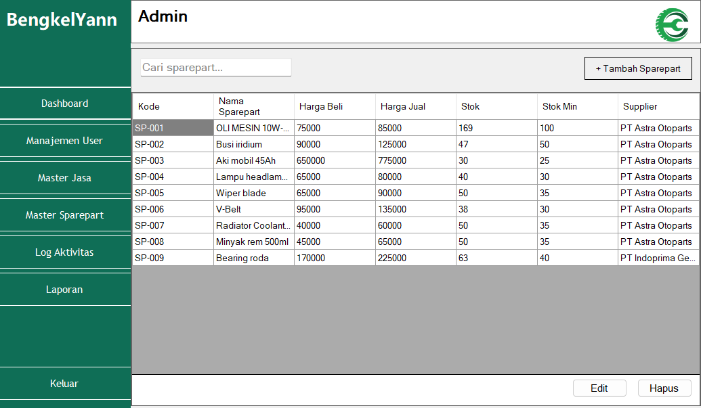

- Memuat kode sparepart, nama, harga beli, harga jual, stok, stok minimum, dan supplier.
- Pencarian mendukung **kode, nama sparepart, atau supplier**. Admin dapat menambah, mengedit, dan menghapus data melalui kontrol yang tersedia.
- Kode sparepart baru dibuat otomatis dengan pola seperti `SP-001`, sehingga tidak perlu diketik manual.
- Harga digunakan sebagai referensi transaksi, sedangkan stok minimum membantu pemantauan kebutuhan pengadaan barang.

#### Log Aktivitas

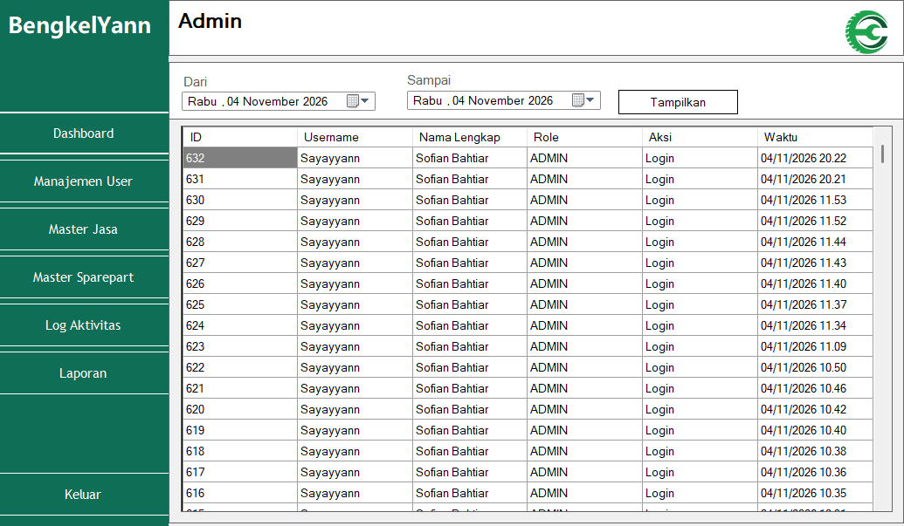

- Menampilkan jejak aktivitas beserta username, nama lengkap, role, aksi, dan waktu kejadian; urutan terbaru ditampilkan terlebih dahulu.
- Filter tanggal membantu menelusuri aktivitas pada periode tertentu. Saat pertama dibuka, daftar memuat seluruh log yang tersedia.
- Aktivitas yang dicatat meliputi login, logout, perubahan data, proses WO, pembayaran, dan ekspor PDF. Aksi terkait WO menggunakan **nomor WO**, sehingga lebih mudah ditelusuri.
- Tabel bersifat baca-saja: layar ini digunakan untuk pemeriksaan, bukan mengedit atau menghapus riwayat.

#### Laporan

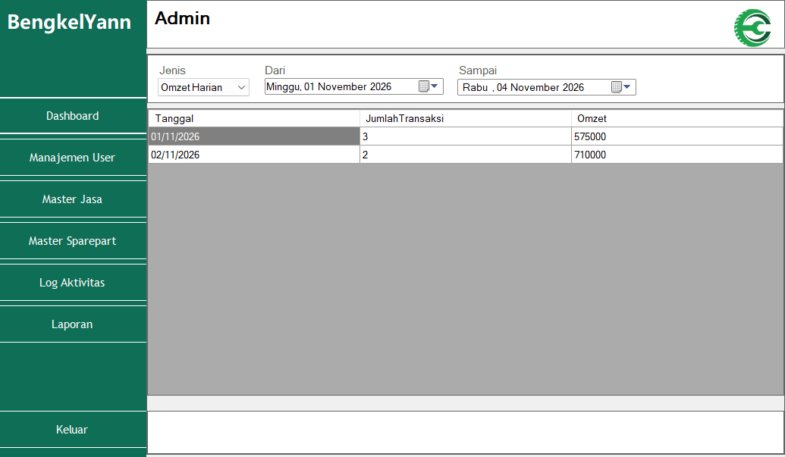

- Menyediakan pilihan **Omzet Harian, Omzet Bulanan, Jasa Terlaris, Sparepart Terlaris, dan Performa Mekanik**.
- Kontrol **Dari** dan **Sampai** menentukan periode data yang digunakan ketika laporan dimuat. Saat dibuka, periode awal adalah bulan berjalan sampai hari ini.
- Contoh pada screenshot adalah **Omzet Harian**: setiap baris berisi tanggal, jumlah transaksi, dan total omzet pada tanggal tersebut.
- Laporan jasa/sparepart membantu melihat pemakaian layanan dan barang, sedangkan performa mekanik merangkum jumlah WO selesai menurut mekaniknya.

### 2. Frontdesk

Frontdesk menjadi titik awal pelayanan: mendata pemilik kendaraan, menerima keluhan, membuat WO, dan memonitor proses servis sampai serah terima.

#### Buat Work Order

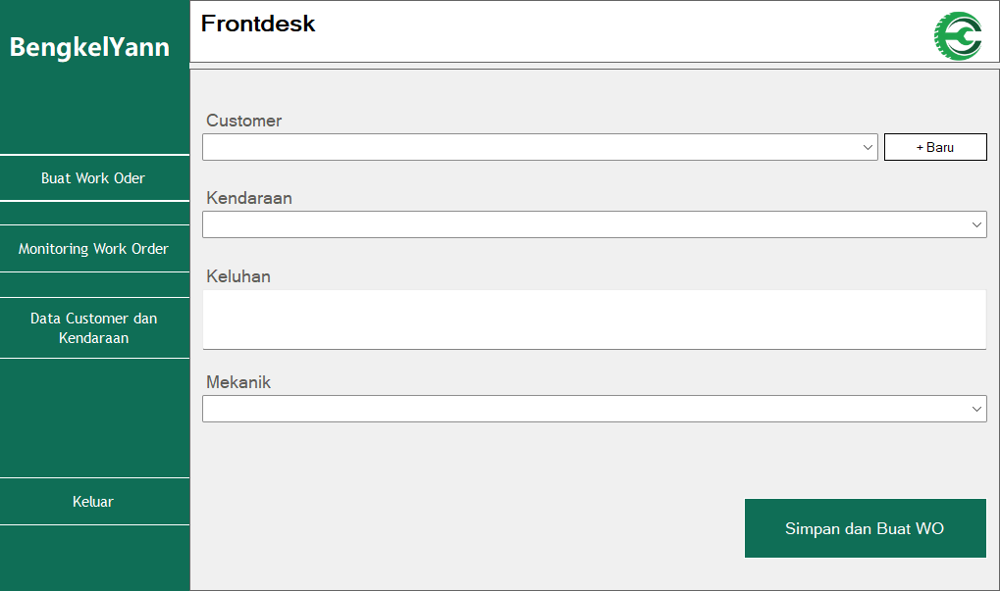

- Memilih **customer**, kendaraan milik customer tersebut, dan mekanik yang ditugaskan, lalu mengisi keluhan kendaraan.
- Tombol tambah customer membantu mencatat pelanggan yang belum terdaftar sebelum melanjutkan pembuatan WO.
- Customer, kendaraan, mekanik, dan keluhan wajib dilengkapi sebelum data disimpan.
- Sistem membuat nomor berformat `WO-YYYYMMDD-NNN`, memberikan status awal `Baru`, dan mencatat pengguna pembuat serta waktu pembuatan.

#### Monitoring Work Order

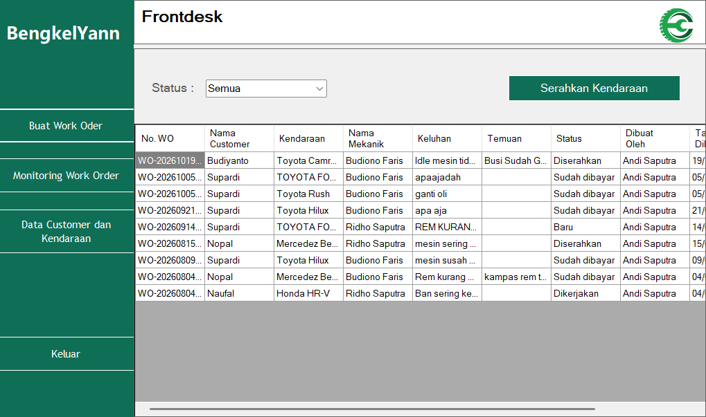

- Menampilkan nomor WO, customer, kendaraan, mekanik, keluhan, temuan, status, pembuat, tanggal pembuatan, serta nama pengambil kendaraan.
- Filter status membantu memusatkan pemantauan pada WO `Baru`, `Dikerjakan`, `Menunggu sparepart`, `Selesai`, `Diserahkan`, atau `Sudah dibayar`; pilihan **Semua** menampilkan seluruh status.
- Tombol **Serahkan Kendaraan** membuka dialog pencatatan nama pengambil untuk WO terpilih. Setelah disimpan, status WO berubah menjadi `Diserahkan`.
- Frontdesk perlu memastikan kesiapan kendaraan dan pembayaran sesuai prosedur bengkel sebelum melakukan serah terima.

#### Data Customer dan Kendaraan

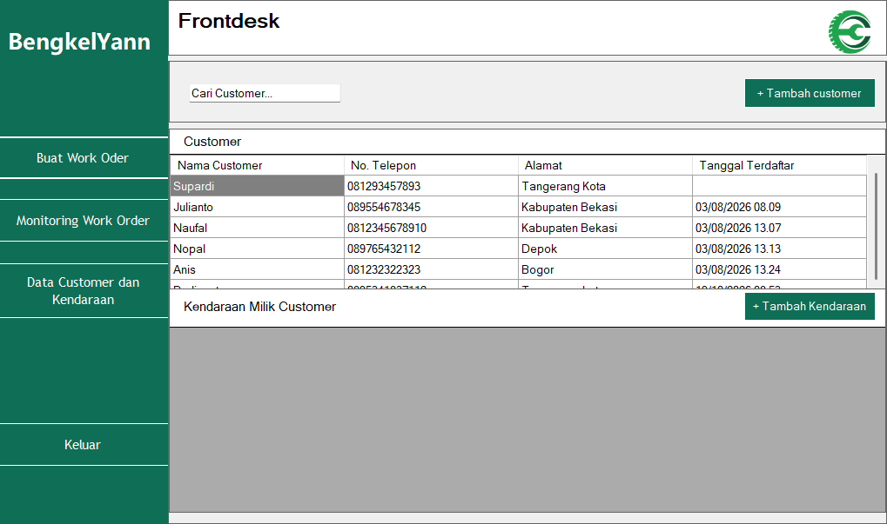

- Bagian customer menampilkan nama, nomor telepon, alamat, dan tanggal terdaftar; pencarian dapat memakai **nama atau nomor HP**.
- Memilih customer menampilkan kendaraan yang terhubung dengannya, termasuk nomor polisi, nama kendaraan, dan tahun.
- Tombol tambah customer digunakan untuk mendaftarkan pelanggan baru, sedangkan tambah kendaraan digunakan untuk menambahkan kendaraan pada customer terpilih.
- Hubungan customer dan kendaraan membantu pemilihan kendaraan saat membuat WO, sehingga identitas pemilik tidak perlu diketik berulang.

### 3. Gudang

Staf gudang mencatat penerimaan barang, memantau ketersediaan stok, dan menindaklanjuti permintaan sparepart dari mekanik.

#### Barang Masuk

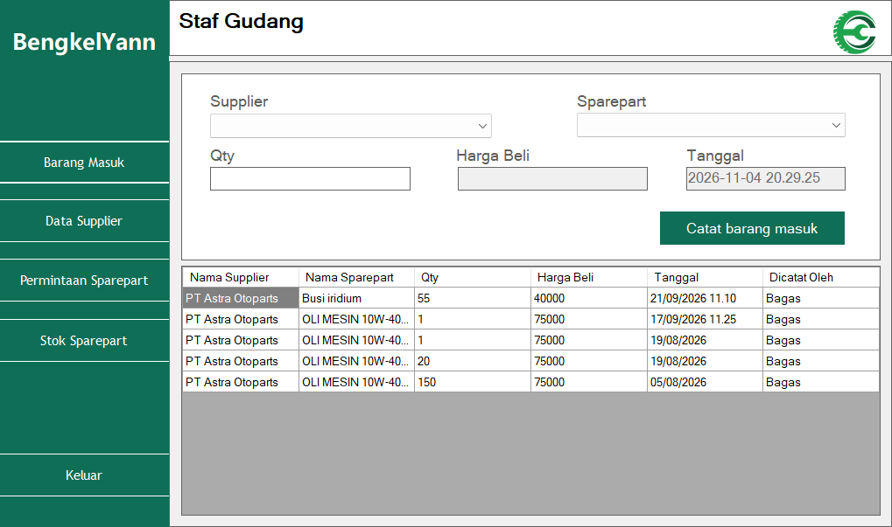

- Memilih supplier dan sparepart, lalu memasukkan jumlah barang yang diterima serta harga belinya. Pilihan sparepart mengikuti supplier yang dipilih.
- Harga beli diisi dari master sebagai nilai awal, sedangkan tanggal/jam penerimaan ditampilkan otomatis.
- Penyimpanan mensyaratkan supplier, sparepart, dan jumlah lebih dari nol; transaksi penerimaan sekaligus **menambah stok sparepart**.
- Tabel riwayat menampilkan supplier, sparepart, jumlah, harga beli, waktu penerimaan, dan pengguna pencatat untuk penelusuran pengadaan.

#### Permintaan Sparepart

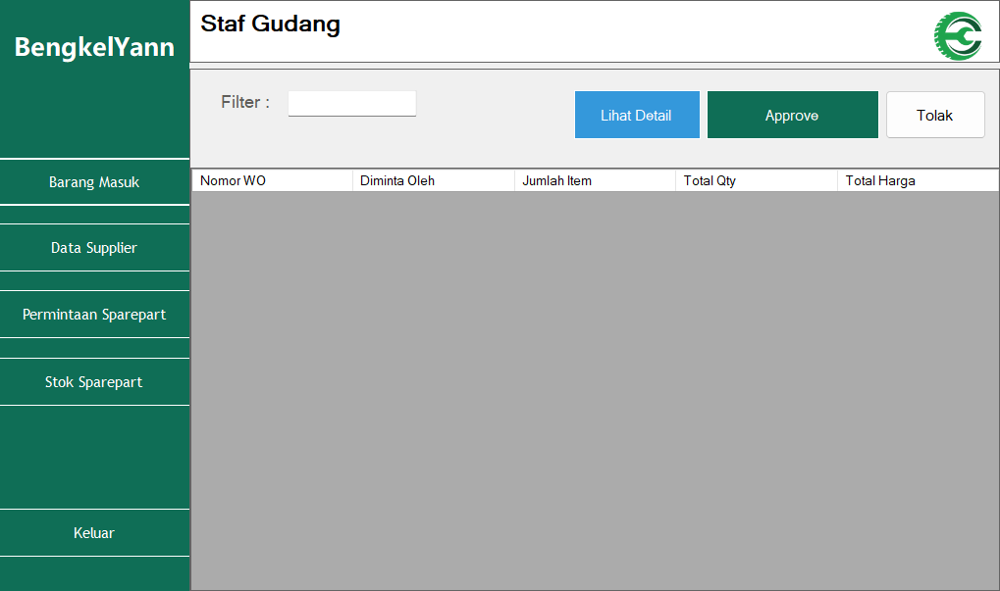

- Daftar berisi permintaan yang masih diproses, dikelompokkan per WO: nomor WO, mekanik peminta, jumlah item, total kuantitas, dan total harga.
- Pencarian menggunakan **nomor WO atau nama mekanik**, sedangkan **Lihat Detail** membuka rincian item yang diminta.
- **Approve** memeriksa ketersediaan seluruh item; jika stok mencukupi, permintaan diterima dan stok dikurangi. Persetujuan dibatalkan apabila ada item dengan stok tidak mencukupi.
- **Tolak** mewajibkan alasan agar mekanik mengetahui penyebab penolakan. Ketika tidak ada permintaan tertunda lagi, WO yang menunggu sparepart dapat kembali berstatus `Dikerjakan`.
- Pada screenshot, tabel kosong karena tidak ada permintaan berstatus `Diproses` pada saat pengambilan.

#### Stok Sparepart

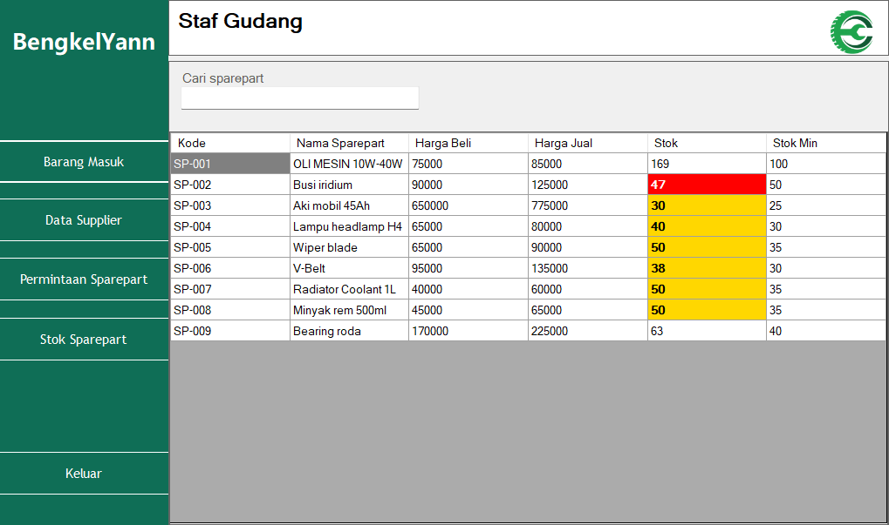

- Menampilkan kode, nama sparepart, harga beli, harga jual, stok tersedia, dan stok minimum; pencarian berdasarkan **kode atau nama**.
- Sel stok diberi warna **merah** jika berada di bawah minimum, dan **kuning/emas** jika berada pada rentang minimum sampai minimum ditambah 15.
- Indikator warna memudahkan staf menentukan barang yang harus segera dipesan kembali.
- Layar ini digunakan untuk pemantauan; penambahan stok dicatat melalui Barang Masuk, sedangkan pengeluaran stok mengikuti persetujuan permintaan sparepart.

#### Data Supplier

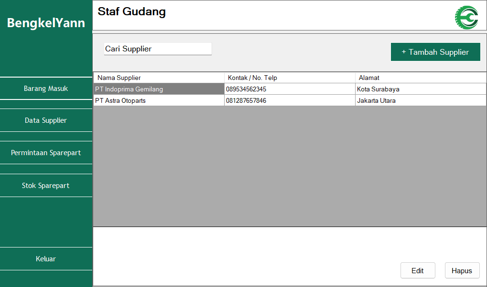

- Menyimpan identitas pemasok berupa **nama supplier, kontak/telepon, dan alamat**.
- Fasilitas tambah dan edit membantu staf menjaga informasi pemasok tetap sesuai untuk kebutuhan pemesanan barang.
- Data supplier digunakan pada master sparepart dan penerimaan barang, sehingga asal pengadaan dapat ditelusuri.

### 4. Mekanik

Mekanik mengakses pekerjaan yang ditugaskan kepadanya, mencatat hasil pemeriksaan, menentukan jasa yang dikerjakan, dan meminta sparepart kepada gudang.

#### Job Mekanik

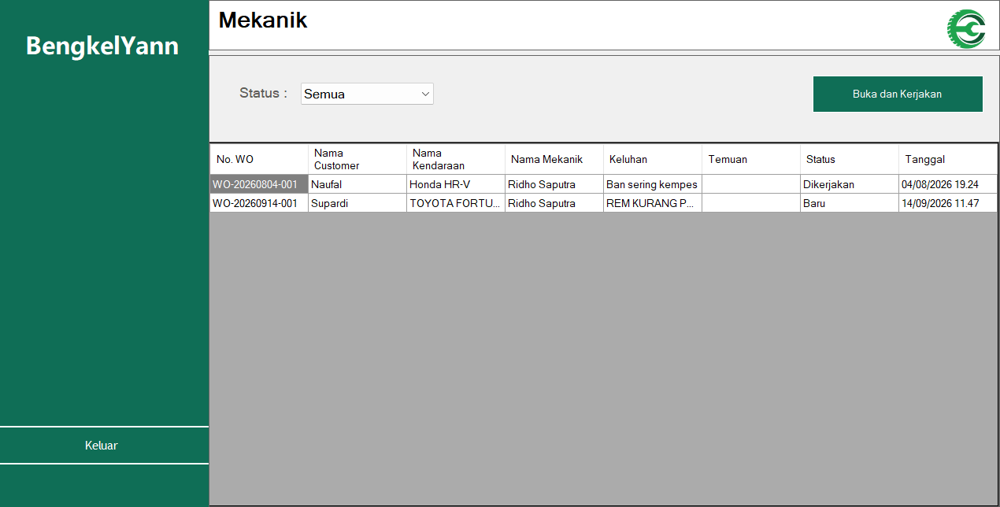

- Daftar hanya menampilkan WO milik **mekanik yang sedang login**, beserta customer, kendaraan, keluhan, temuan, status, dan tanggal.
- Filter tersedia untuk **Semua, Belum dikerjakan, Sedang dikerjakan, Menunggu sparepart, dan Selesai**.
- WO berstatus `Sudah dibayar` atau `Diserahkan` tidak ditampilkan agar daftar berfokus pada pekerjaan yang masih relevan.
- Setelah memilih WO, tombol **Buka dan Kerjakan** membuka form Detail Servis. Saat kembali ke daftar, data dimuat ulang dan pilihan filter status tetap diterapkan.

#### Detail Servis

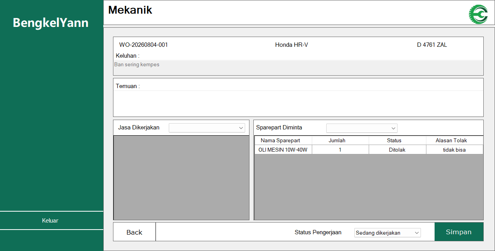

- Bagian atas menampilkan nomor WO, kendaraan, nomor polisi, dan keluhan awal sebagai konteks pemeriksaan.
- Kolom **Temuan** digunakan untuk mencatat hasil pemeriksaan. Bagian **Jasa Dikerjakan** digunakan untuk memilih layanan yang dilakukan pada kendaraan.
- Bagian **Sparepart Diminta** menampilkan item, jumlah, status permintaan, dan alasan penolakan apabila permintaan ditolak gudang.
- **Simpan** mencatat perubahan detail dan status pengerjaan. Permintaan sparepart baru disimpan sebagai `Diproses` dan membuat WO masuk status `Menunggu sparepart`.
- Tombol **Back** mengembalikan mekanik ke daftar job. Screenshot memperlihatkan contoh permintaan yang telah ditolak beserta alasannya.

### 5. Kasir

Kasir menangani penagihan WO selesai, penerimaan pembayaran, pencetakan bukti transaksi, serta rekap pendapatan.

#### Invoice

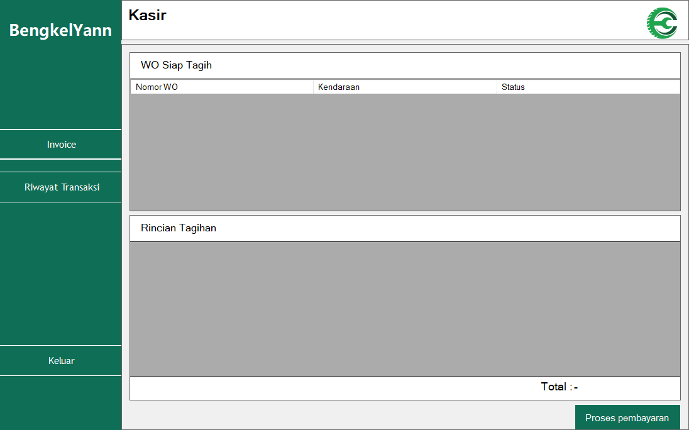

- Bagian **WO Siap Tagih** hanya memuat WO berstatus `Selesai`, dengan informasi nomor WO, kendaraan, dan statusnya.
- Memilih WO menampilkan rincian jasa dan sparepart, termasuk jenis item, nama, kuantitas, harga, serta total tagihan. Hanya sparepart yang sudah diterima/disetujui yang dimasukkan ke tagihan.
- **Proses Bayar** membuka dialog pembayaran dengan metode **Tunai atau Qris**, jumlah uang diterima, dan perhitungan kembalian. Pembayaran dengan jumlah kurang dari total ditolak.
- Pembayaran yang berhasil dicatat mengubah status WO menjadi `Sudah dibayar` dan membuka pratinjau struk untuk dicetak.
- Screenshot menunjukkan kondisi ketika belum ada WO berstatus `Selesai`, sehingga daftar dan rincian tagihan masih kosong.

#### Riwayat Transaksi dan Ekspor PDF

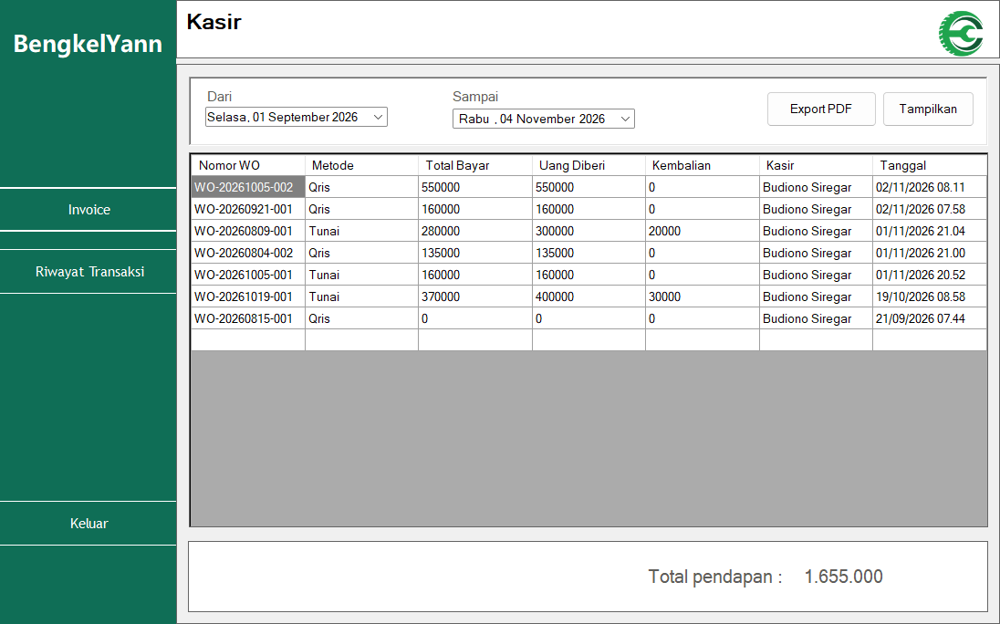

- Tentukan tanggal **Dari** dan **Sampai**, lalu pilih **Tampilkan** untuk memuat transaksi pada periode tersebut. Tanggal awal tidak boleh melewati tanggal akhir.
- Tabel menampilkan nomor WO, metode pembayaran, total bayar, uang yang diberikan, kembalian, nama kasir, dan waktu transaksi.
- **Total pendapatan** menjumlahkan transaksi yang tampil, mencakup seluruh metode pembayaran dalam periode tersebut. Contoh screenshot memakai periode September–November 2026 agar riwayat yang tersedia terlihat.
- Tombol **Export PDF** menghasilkan laporan berisi identitas bengkel, periode, rincian transaksi, total pendapatan, dan nama pengguna pengekspor dengan ruang tanda tangan.

## Bahasa Pemrograman

- **C#** — seluruh logika aplikasi dan antarmuka.
- **SQL (T-SQL)** — query dan manipulasi data pada SQL Server.

## Teknologi dan Library

| Komponen | Versi | Keterangan |
|---|---|---|
| C# | - | Bahasa pemrograman utama |
| .NET Framework | 4.7.2 | Target framework aplikasi |
| Windows Forms | - | Framework antarmuka desktop |
| SQL Server Express | - | Basis data relasional |
| iTextSharp | 5.5.13.6 | Pembuatan dan ekspor laporan PDF |
| BouncyCastle.Cryptography | 2.6.2 | Dependensi kriptografi untuk iTextSharp |
| System.Data.SqlClient | - | Akses database melalui ADO.NET |
| System.Windows.Forms.DataVisualization | - | Grafik dan visualisasi data pada dashboard |
| System.Drawing | - | Pengolahan logo, gambar, dan struk |
| System.Xml.Linq | - | Pemrosesan data XML |

## Struktur Proyek

```text
Kerja_Projek/
├── Kerja_Projek.sln
├── packages.config
├── README.md
├── docs/
│   └── screenshots/            # Screenshot fitur per hak akses
└── Kerja_Projek/
    ├── Admin/                  # Master data, dashboard, laporan, audit log
    ├── Fondasi/                # Form login dan menu utama per role
    ├── Frontdesk/              # Customer, kendaraan, dan Work Order
    ├── Gudang/                 # Stok, barang masuk, permintaan sparepart
    ├── Kasir/                  # Invoice, pembayaran, riwayat transaksi
    ├── KumpulanFormDialog/     # Form dialog tambah/edit/pembayaran
    ├── Mekanik/                # Job mekanik dan detail servis
    ├── Properties/             # Resource, pengaturan, dan logo
    ├── Assets/                 # Aset gambar/logo
    ├── koneksi.cs              # Koneksi database dan helper audit log
    ├── usersession.cs          # Sesi pengguna yang sedang login
    └── hashpassword.cs         # Helper hash password
```

## Kebutuhan Sistem

- Windows 10/11
- Visual Studio 2022 (dengan workload **.NET desktop development**)
- .NET Framework 4.7.2 Developer Pack
- SQL Server Express
- NuGet Package Restore untuk `iTextSharp` dan `BouncyCastle.Cryptography`

## Cara Menjalankan

1. Clone repositori:

   ```bash
   git clone https://github.com/Sayayyan/KP_SofianBahtiar.git
   ```

2. Buka `Kerja_Projek.sln` menggunakan Visual Studio.
3. Lakukan **Restore NuGet Packages**.
4. Sesuaikan connection string pada `Kerja_Projek/koneksi.cs` dengan instance SQL Server lokal:

   ```csharp
   string lokasi = "Data source = NAMA_SERVER\\SQLEXPRESS; database = KerjaProjek; integrated security = true";
   ```

5. Pastikan database `KerjaProjek` sudah tersedia pada instance SQL Server tersebut.
6. Build solution, lalu jalankan aplikasi dengan tombol **Start**.

Alternatif build melalui command line:

```bash
MSBuild.exe Kerja_Projek.sln /t:Rebuild /p:Configuration=Debug
```

## Catatan

- Seluruh aksi penting pengguna dicatat ke tabel `audit_log`.
- Logo aplikasi tersedia di `Kerja_Projek/Assets/logopkk.png`.
- Hak akses menu menyesuaikan role pengguna yang sedang login.

## Lisensi

Proyek ini menggunakan lisensi [MIT](LICENSE).

---

<p align="center">
  Dibuat oleh <strong>Sofian Bahtiar</strong>
</p>
